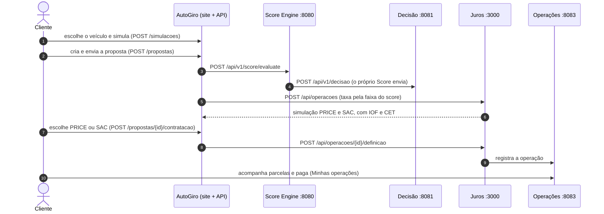

# AutoGiro

Plataforma web de **financiamento de veículos**: o cliente explora o estoque, simula as parcelas e acompanha as operações contratadas, com pagamentos, atrasos e encargos.

O foco desta etapa é um **front-end completo e organizado**, já ligado a um back-end real de operações e com o banco de dados relacional modelado.

## Veja funcionando

**Site publicado:** [autogiroproject-s.vercel.app](https://autogiroproject-s.vercel.app)

Na versão publicada, o catálogo de veículos vem do banco de dados (Supabase) e tem fotos reais. As operações usam dados simulados (mock), porque o back-end de operações roda localmente. Para ver a integração real, siga o passo a passo de [Como rodar](#como-rodar).

## O que foi feito

### Veículos e simulador
- Catálogo lido do banco de dados (Supabase), com **fotos reais** de cada modelo (Wikimedia Commons, licenças livres, com link para autor e licença). Se o banco não responder, o site mostra o catálogo de exemplo.
- Vitrine com busca por marca ou modelo, categorias em um toque, preço máximo e ordenação.
- **Favoritos** (ficam salvos no navegador) e **comparador** de até 3 veículos lado a lado.
- Página de cada veículo com ficha técnica, opcionais, parcelas por prazo, veículos parecidos e botão de compartilhar.
- **Simulador de financiamento**: entrada (atalhos de 0% a 40%), prazo de 12 a 60 meses, **perfil de crédito A a D** e sistema **PRICE** ou **SAC**. A taxa de cada perfil é a mesma da modalidade `VEICULOS` do serviço de juros (1,50% a 3,00% ao mês).
- Seções de como funciona, tabela de taxas por perfil e perguntas frequentes.
- Resultado na hora: parcela, valor financiado, total pago, total de juros e cronograma completo. Os cálculos são feitos em centavos inteiros, e a última parcela zera o saldo ao centavo.

### Área do lojista (cadastro de veículos)
- Página `#/admin`, com login do Supabase. Só contas da tabela `administradores` conseguem cadastrar; quem tenta sem permissão é barrado pelo próprio banco (RLS).
- Cadastro, edição e exclusão de veículos, com envio de foto (reduzida no navegador e guardada no Supabase Storage), cor, opcionais e descrição.
- Situação de cada veículo: disponível, reservado, vendido ou oculto. Vendido e oculto saem da vitrine, mas continuam no banco.

**Como liberar um administrador:** crie a conta em `#/admin`, confirme o e-mail e entre. A página mostra um comando `insert into public.administradores ...` com o seu ID. Rode esse comando no SQL Editor do Supabase e recarregue.

### Análise de crédito (integrada ao Score Engine)
- Formulário com cadastro, renda, dívidas e o financiamento desejado. Vindo da página de um veículo, o valor e a entrada já chegam preenchidos.
- Envia para o **Score Engine** (`POST /api/v1/score/evaluate`) e mostra o score de 0 a 1000, a classificação, a chance de inadimplência e o que pesou em cada um dos 4 componentes.
- Liga o score à faixa de juros (A a E) do serviço de juros e calcula a parcela real. O botão abre o simulador já com o perfil do cliente.
- Sem o Score rodando (como no site publicado), o cálculo é feito no navegador com as mesmas regras do modelo `SCORE_PF v1.1.0`. A conta foi comparada com o código Java do Score em 5.000 casos, sem nenhuma diferença.

### Minhas operações (integrado ao back-end)
- Lista de operações com busca por número e filtro por situação (em dia, em atraso, inadimplente, liquidada).
- Detalhe da operação em três abas: **Resumo** (saldo devedor, valor para quitar, taxas e CET), **Parcelas** (situação, atraso e encargos) e **Histórico** (linha do tempo).
- **Pagamento de parcela** com confirmação e a divisão do valor entre multa, juros de mora, juros e amortização.
- **Data de referência** global: permite simular o atraso e os encargos em qualquer data.

### Qualidade da interface
- Estados de carregamento (skeletons), erro (com "Tentar de novo") e lista vazia em todas as telas.
- Responsivo, com modo claro e escuro automático, navegação por teclado e rótulos de acessibilidade.
- Reenvio seguro de pagamentos: cada tentativa leva um identificador próprio para evitar duplicidade.

### Banco de dados
Modelo relacional em PostgreSQL (Supabase) com 7 tabelas, restrições de integridade e segurança por linha (RLS):

| Tabela | Conteúdo |
|---|---|
| `veiculos` | Catálogo de veículos, com foto, cor, opcionais e descrição |
| `administradores` | Contas que podem cadastrar veículos |
| `clientes` | Cadastro ligado ao login do Supabase |
| `simulacoes` | Simulações geradas (valores, prazo, taxa, sistema, totais) |
| `simulacao_parcelas` | Cronograma de cada simulação |
| `propostas` | Pedido do cliente, com vínculo à operação (`numero_operacao`) |
| `proposta_eventos` | Histórico de status, gerado automaticamente |

O cliente só enxerga os próprios dados e não consegue aprovar a própria proposta. O script completo está em [`docs/autogiro-schema.sql`](docs/autogiro-schema.sql).

## Arquitetura

O front não chama a API diretamente: tudo passa por uma camada de serviços, que escolhe entre dados simulados (mock) e API real por variável de ambiente. Assim, trocar de mock para back-end não exige mexer nas telas.

```
Tela (pages)  →  Hook (useAsync)  →  Serviço  →  mock  ou  httpClient  →  API
```

```
src/
├── App.jsx                     # navegação e data de referência
├── pages/                      # Veículos, Operações, Detalhe da operação
├── components/
│   ├── ui/                     # Skeleton, mensagens de erro e vazio
│   ├── vehicles/               # cartão, filtros e simulador
│   └── operacoes/              # situação, pagamento de parcela
├── hooks/                      # useAsync, useDebounce, useHashRoute
├── services/
│   ├── api/                    # contratos, endpoints e cliente HTTP
│   ├── mocks/                  # dados simulados no mesmo formato da API
│   ├── operacaoService.js      # operações (mock ou API real)
│   ├── vehicleService.js       # catálogo
│   └── simulacaoService.js     # cálculo PRICE e SAC
├── config/env.js               # variáveis de ambiente
├── utils/                      # formatação de moeda, datas e rótulos
└── styles/                     # tokens de design e estilos globais
```

## Tecnologias

- **Front-end:** React 18 e Vite (JavaScript), CSS próprio, sem bibliotecas de interface.
- **Back-end de operações:** [financial-operations-service](https://github.com/unicsul-finops/financial-operations-service) (Go, Gin e PostgreSQL), com contratos documentados em OpenAPI.
- **Banco do AutoGiro:** Supabase (PostgreSQL).
- **Publicação:** Vercel, a partir deste repositório. A cada atualização enviada ao GitHub, o site é publicado de novo.

## Como rodar

Pré-requisito: Node.js (versão LTS).

```bash
npm install
cp .env.example .env     # no Windows (PowerShell): Copy-Item .env.example .env
npm run dev
```

Abra `http://localhost:5173`. Com o `.env` padrão, tudo funciona com dados simulados.

### Usando o back-end real de operações

1. Suba o serviço com Docker: `docker compose up -d --build` na pasta do `financial-operations-service`.
2. Registre uma operação de exemplo pelo Swagger (`http://localhost:8083/swagger`, rota `POST /operacoes`).
3. No `.env` do AutoGiro, troque `VITE_MOCK_OPERACOES` para `false`.
4. Reinicie o `npm run dev`.

### Usando o Score Engine real

1. Na pasta do [Score-Engine](https://github.com/viniciusgm25/Score-Engine), crie o `.env` a partir do `.env.exemplo` e preencha a senha do PostgreSQL.
2. Se a Decisão (porta 8081) não estiver rodando, coloque `DECISION_ENABLED=false` nesse `.env`. Sem isso, o Score responde erro ao tentar avisar a Decisão.
3. Rode `mvn spring-boot:run` na raiz do Score. Ele sobe na porta 8080 e já libera chamadas de `localhost`.
4. No `.env` do AutoGiro, troque `VITE_MOCK_SCORE` para `false` e reinicie o `npm run dev`.

### Variáveis de ambiente

| Variável | Padrão | Função |
|---|---|---|
| `VITE_MOCK_VEHICLES` | `false` | `true` usa só o catálogo de exemplo, sem o banco |
| `VITE_SUPABASE_URL` | URL do projeto | Endereço do Supabase |
| `VITE_SUPABASE_KEY` | chave publicável | Chave pública do Supabase (pode ficar no site; quem protege os dados são as regras do banco) |
| `VITE_MOCK_OPERACOES` | `true` | `false` usa o serviço de operações real |
| `VITE_MOCK_CREDITO` | `true` | `false` lê as taxas por perfil do serviço de juros |
| `VITE_MOCK_SCORE` | `true` | `false` usa o Score Engine real |
| `VITE_SCORE_URL` | `http://localhost:8080` | Endereço do Score Engine |
| `VITE_API_URL` | `http://localhost:8083` | Endereço do serviço de operações |
| `VITE_JUROS_URL` | `http://localhost:3000` | Endereço do serviço de juros |

## Integração com o serviço de operações

| Tela | Endpoint |
|---|---|
| Lista de operações | `GET /operacoes` |
| Resumo | `GET /operacoes/:id/resumo` |
| Parcelas | `GET /operacoes/:id/parcelas` |
| Histórico | `GET /operacoes/:id/historico` |
| Pagar parcela | `POST /operacoes/:id/parcelas/:numero/pagamentos` |

Referência completa dos campos, tipos e regras: [`docs/API.md`](docs/API.md).

## Contrato da API do AutoGiro

O contrato do nosso back-end está em [`docs/autogiro-api.openapi.yaml`](docs/autogiro-api.openapi.yaml) (OpenAPI 3.0). Ele cobre catálogo, simulação, política de crédito, cliente, propostas, análise de crédito e contratação, e já está alinhado ao Score Engine e ao serviço de juros. Só a Decisão continua pendente, até o contrato dela chegar.

**[Abrir o contrato interativo (Swagger)](https://autogiroproject-s.vercel.app/contrato/)** · [Baixar o YAML](docs/autogiro-api.openapi.yaml)

### Fluxo entre os serviços



### Rotas e campos

<!-- API:INICIO -->
> Gerado a partir de [`docs/autogiro-api.openapi.yaml`](docs/autogiro-api.openapi.yaml) pelo comando `npm run docs:api`. Não edite este trecho à mão: edite o YAML.

**AutoGiro API 1.0.0** · Base: `http://localhost:3001`

#### Sistema

| Método | Caminho | O que faz | Envia | Recebe | Acesso |
|---|---|---|---|---|---|
| `GET` | `/health` | Verifica se a API está no ar |  | 200 object | Pública |

#### Veículos
Catálogo público

| Método | Caminho | O que faz | Envia | Recebe | Acesso |
|---|---|---|---|---|---|
| `GET` | `/veiculos` | Lista veículos com filtros, ordenação e paginação |  | 200 `ListaVeiculos` | Pública |
| `GET` | `/veiculos/{id}` | Detalhe de um veículo |  | 200 `Veiculo` | Pública |

#### Simulações
Cálculo PRICE e SAC

| Método | Caminho | O que faz | Envia | Recebe | Acesso |
|---|---|---|---|---|---|
| `POST` | `/simulacoes` | Calcula e registra uma simulação | `SimulacaoRequest` | 201 `Simulacao` | Login |
| `GET` | `/simulacoes/{id}` | Consulta uma simulação do usuário logado |  | 200 `Simulacao` | Login |

#### Crédito
Política de crédito: prazos e taxas por perfil

| Método | Caminho | O que faz | Envia | Recebe | Acesso |
|---|---|---|---|---|---|
| `GET` | `/credito/politica` | Política de crédito para veículos (prazos e taxa por faixa de score) |  | 200 `PoliticaCredito` | Pública |

#### Clientes
Cadastro do usuário logado

| Método | Caminho | O que faz | Envia | Recebe | Acesso |
|---|---|---|---|---|---|
| `GET` | `/clientes/me` | Cadastro do usuário logado |  | 200 `Cliente` | Login |
| `PUT` | `/clientes/me` | Cria ou atualiza o cadastro do usuário logado | `ClienteRequest` | 200 `Cliente` | Login |

#### Propostas
Pedido de financiamento e análise de crédito

| Método | Caminho | O que faz | Envia | Recebe | Acesso |
|---|---|---|---|---|---|
| `GET` | `/propostas` | Lista as propostas do usuário logado |  | 200 lista de `Proposta` | Login |
| `POST` | `/propostas` | Cria uma proposta em rascunho | `PropostaRequest` | 201 `Proposta` | Login |
| `GET` | `/propostas/{id}` | Consulta uma proposta |  | 200 `Proposta` | Login |
| `POST` | `/propostas/{id}/envio` | Envia o rascunho (RASCUNHO para ENVIADA) |  | 200 `Proposta` | Login |
| `POST` | `/propostas/{id}/cancelamento` | Cancela uma proposta em rascunho ou enviada |  | 200 `Proposta` | Login |
| `POST` | `/propostas/{id}/contratacao` | Contrata a proposta aprovada, escolhendo PRICE ou SAC | `ContratacaoRequest` | 200 `Contratacao` | Login |
| `GET` | `/propostas/{id}/eventos` | Histórico de status da proposta |  | 200 lista de `EventoProposta` | Login |
| `POST` | `/propostas/{id}/analise-credito` | Analisa o crédito: Score, Decisão e Juros *(pendente)* | `AnaliseCreditoRequest` | 200 `AnaliseCredito` | Login |

<details>
<summary><strong>Campos de cada objeto (20 schemas)</strong></summary>

##### `Erro`

| Campo | Tipo | Obrigatório | Descrição |
|---|---|---|---|
| `erro` | string | sim | Mensagem legível para o usuário. |
| `codigo` | string | sim | Código estável: VALIDACAO, NAO_AUTENTICADO, NAO_ENCONTRADO, ESTADO_INVALIDO, ESTEIRA_INDISPONIVEL. |
| `detalhes` | lista de object |  |  |

##### `CategoriaVeiculo`

Valores: `hatch`, `sedan`, `suv`, `picape`, `moto`

##### `StatusProposta`

Valores: `RASCUNHO`, `ENVIADA`, `EM_ANALISE`, `APROVADA`, `REPROVADA`, `CONTRATADA`, `CANCELADA`

##### `Veiculo`

| Campo | Tipo | Obrigatório | Descrição |
|---|---|---|---|
| `id` | string (uuid) | sim |  |
| `marca` | string | sim |  Ex.: `Fiat` |
| `modelo` | string | sim |  Ex.: `Argo` |
| `versao` | string |  |  Ex.: `1.0 Drive` |
| `ano` | integer | sim |  Ex.: `2021` |
| `quilometragem` | integer | sim |  Ex.: `42000` |
| `preco` | number (double) | sim |  Ex.: `58900` |
| `categoria` | `CategoriaVeiculo` | sim |  |
| `combustivel` | `flex`, `gasolina`, `diesel`, `eletrico` | sim |  |
| `cambio` | `manual`, `automatico` | sim |  |
| `cidade` | string | sim |  Ex.: `São Paulo` |
| `status` | `disponivel`, `reservado` | sim |  |
| `cor` | string |  |  Ex.: `Prata` |
| `opcionais` | lista de string |  |  |
| `descricao` | string |  |  |
| `fotoUrl` | string (uri) |  | Sempre https. Foto enviada pelo lojista (Supabase Storage, bucket `veiculos`) ou de uma fonte com licença livre. Ex.: `https://commons.wikimedia.org/wiki/Special:FilePath/Toyota_Corolla_2.0_XEi_2022.jpg?width=960` |
| `fotoCredito` | string |  |  Ex.: `Wikimedia Commons` |
| `fotoFonteUrl` | string (uri) |  | Página com autor e licença da foto. |

##### `ListaVeiculos`

| Campo | Tipo | Obrigatório | Descrição |
|---|---|---|---|
| `itens` | lista de `Veiculo` | sim |  |
| `total` | integer | sim | Total de veículos que atendem aos filtros. |
| `pagina` | integer | sim |  |
| `tamanhoPagina` | integer | sim |  |

##### `SimulacaoRequest`

| Campo | Tipo | Obrigatório | Descrição |
|---|---|---|---|
| `veiculoId` | string (uuid) | sim |  |
| `entrada` | number | sim | Menor que o preço do veículo. Ex.: `11780` |
| `prazoMeses` | integer | sim | Limites da modalidade VEICULOS; consulte `GET /credito/politica`. Ex.: `48` |
| `sistema` | `PRICE`, `SAC` | sim |  |
| `faixaRisco` | `A`, `B`, `C`, `D` | sim | Perfil de crédito estimado. A taxa vem da política. O score real, que define a taxa final, só é conhecido na análise de crédito. A faixa E é recusada e não é aceita aqui. Ex.: `B` |

##### `Parcela`

| Campo | Tipo | Obrigatório | Descrição |
|---|---|---|---|
| `numero` | integer | sim |  |
| `valor` | number (double) | sim |  |
| `juros` | number (double) | sim |  |
| `amortizacao` | number (double) | sim |  |
| `saldoDevedor` | number (double) | sim |  |

##### `Simulacao`

| Campo | Tipo | Obrigatório | Descrição |
|---|---|---|---|
| `id` | string (uuid) | sim |  |
| `veiculoId` | string (uuid) | sim |  |
| `valorVeiculo` | number (double) | sim |  |
| `entrada` | number (double) | sim |  |
| `prazoMeses` | integer | sim |  |
| `taxaMensalPercentual` | number | sim |  Ex.: `1.8` |
| `sistema` | `PRICE`, `SAC` | sim |  |
| `valorFinanciado` | number (double) | sim | valorVeiculo menos entrada. |
| `primeiraParcela` | number (double) | sim |  |
| `ultimaParcela` | number (double) | sim |  |
| `totalPago` | number (double) | sim | Soma das parcelas, sem a entrada. |
| `totalJuros` | number (double) | sim |  |
| `criadaEm` | string (date-time) | sim |  |
| `parcelas` | lista de `Parcela` | sim |  |
| `faixaRisco` | `A`, `B`, `C`, `D` | sim | Perfil usado na simulação. O que fica gravado é a taxa (`taxaMensalPercentual`). |

##### `ClienteRequest`

| Campo | Tipo | Obrigatório | Descrição |
|---|---|---|---|
| `nome` | string | sim |  |
| `email` | string (email) | sim |  |
| `telefone` | string |  |  Ex.: `11999998888` |

##### `Cliente`

| Campo | Tipo | Obrigatório | Descrição |
|---|---|---|---|
| `id` | string (uuid) |  |  |
| `criadoEm` | string (date-time) |  |  |

##### `PropostaRequest`

| Campo | Tipo | Obrigatório | Descrição |
|---|---|---|---|
| `veiculoId` | string (uuid) | sim |  |
| `simulacaoId` | string (uuid) |  |  |
| `observacao` | string |  |  |

##### `Proposta`

| Campo | Tipo | Obrigatório | Descrição |
|---|---|---|---|
| `id` | string (uuid) | sim |  |
| `clienteId` | string (uuid) | sim |  |
| `veiculoId` | string (uuid) | sim |  |
| `simulacaoId` | string (uuid) |  |  |
| `status` | `StatusProposta` | sim |  |
| `numeroOperacao` | string |  | Preenchido pelo back-end quando a operação é registrada no serviço de operações. Ex.: `OP-2026-0001` |
| `observacao` | string |  |  |
| `criadaEm` | string (date-time) | sim |  |
| `atualizadaEm` | string (date-time) | sim |  |

##### `EventoProposta`

| Campo | Tipo | Obrigatório | Descrição |
|---|---|---|---|
| `id` | integer (int64) | sim |  |
| `status` | `StatusProposta` | sim |  |
| `observacao` | string |  |  |
| `criadoEm` | string (date-time) | sim |  |

##### `AnaliseCreditoRequest`
Dados que o Score Engine usa (bloco `perfilPF`). Os nomes seguem o contrato dele; o back-end só repassa.

| Campo | Tipo | Obrigatório | Descrição |
|---|---|---|---|
| `cpf` | string | sim | Só dígitos, com dígitos verificadores válidos (o serviço de juros confere). Dado pessoal: nunca em log. Ex.: `52998224725` |
| `rendaMensal` | number | sim |  Ex.: `8500` |
| `dividaTotal` | number | sim | Soma das dívidas em aberto. Ex.: `1200` |
| `idade` | integer | sim |  Ex.: `34` |
| `estadoCivil` | `SOLTEIRO`, `CASADO`, `UNIAO_ESTAVEL`, `DIVORCIADO`, `VIUVO` | sim |  Ex.: `CASADO` |
| `numeroDependentes` | integer | sim | Cada dependente desconta R$ 600 da renda na capacidade financeira. Ex.: `1` |
| `diasAtrasoUltimos12Meses` | integer | sim |  Ex.: `0` |
| `limiteRotativoUtilizado` | number | sim | Cartão e cheque especial usados. Ex.: `1500` |
| `limiteRotativoTotal` | number | sim |  Ex.: `6000` |
| `mesesNoEmpregoAtual` | integer | sim |  Ex.: `36` |
| `mesesRelacionamentoBanco` | integer | sim | 0 envia `primeiroRelacionamento: true` ao Score. Ex.: `48` |
| `forcarRecalculo` | boolean |  | O Score reaproveita um resultado de até 30 dias para os mesmos dados; true força um cálculo novo. |

##### `AnaliseCredito`

| Campo | Tipo | Obrigatório | Descrição |
|---|---|---|---|
| `identificadorOperacao` | string | sim | Identificador da operação criada no serviço de juros, quando a análise é aprovada. Ex.: `OP-2026-0001` |
| `score` | object | sim | Resposta do Score Engine, sem os dados pessoais. |
| `perfilJuros` | object | sim | Faixa de juros (serviço de juros) em que o scoreFinal cai. |
| `decisao` | object |  | Formato provisório até a Decisão enviar o contrato. |

##### `FaixaCredito`

| Campo | Tipo | Obrigatório | Descrição |
|---|---|---|---|
| `faixa` | `A`, `B`, `C`, `D`, `E` | sim |  |
| `scoreMin` | integer | sim |  Ex.: `800` |
| `scoreMax` | integer | sim |  Ex.: `1000` |
| `taxaMensalPercentual` | number | sim | Nulo na faixa E (contratação recusada). Ex.: `1.5` |
| `taxaAnualPercentual` | number | sim |  Ex.: `19.56` |
| `descricao` | string | sim |  Ex.: `Risco muito baixo` |
| `permiteContratacao` | boolean | sim |  |

##### `PoliticaCredito`

| Campo | Tipo | Obrigatório | Descrição |
|---|---|---|---|
| `modalidade` | string | sim |  Ex.: `VEICULOS` |
| `prazoMinMeses` | integer | sim |  Ex.: `12` |
| `prazoMaxMeses` | integer | sim |  Ex.: `60` |
| `tetoTaxaMensalPercentual` | number | sim |  Ex.: `3` |
| `faixas` | lista de `FaixaCredito` | sim |  |

##### `ContratacaoRequest`

| Campo | Tipo | Obrigatório | Descrição |
|---|---|---|---|
| `sistema` | `PRICE`, `SAC` | sim |  |

##### `Contratacao`

| Campo | Tipo | Obrigatório | Descrição |
|---|---|---|---|
| `proposta` | `Proposta` | sim |  |
| `operacao` | object | sim |  |

##### `ComponenteScore`

| Campo | Tipo | Obrigatório | Descrição |
|---|---|---|---|
| `nome` | string | sim |  Ex.: `Histórico de Pagamento` |
| `pontuacao` | number | sim |  Ex.: `850` |
| `pontuacaoMaxima` | number | sim |  Ex.: `1000` |
| `pesoPonderado` | number | sim | Fração. Pesos do modelo PF: histórico 0,35, capacidade 0,30, endividamento 0,20, estabilidade 0,15. Ex.: `0.35` |
| `motivo` | string | sim |  Ex.: `Pontualidade integral na liquidação dos compromissos financeiros.` |

</details>
<!-- API:FIM -->

## Decisões de projeto

- **Dinheiro sem erro de arredondamento:** o simulador calcula em centavos inteiros, e a API usa decimais exatos.
- **Uma fonte da verdade:** parcelas e pagamentos ficam no serviço de operações; o banco do AutoGiro guarda apenas o vínculo (`numero_operacao`).
- **Mock com o mesmo formato da API:** as telas foram validadas antes do back-end existir e continuaram iguais depois da integração.
- **Segurança no banco:** regras por linha (RLS) e privilégios mínimos, para que decisões como aprovar uma proposta fiquem só no back-end.

## Próximos passos

- Salvar as simulações no Supabase.
- Login de clientes e criação de propostas a partir de uma simulação.
- Telas de amortização antecipada e de liquidação da operação.
- Integração com a Decisão, assim que o contrato dela chegar, e com o serviço de juros para contratar a operação.

## Equipe

Preencha com os nomes dos integrantes e a instituição.
